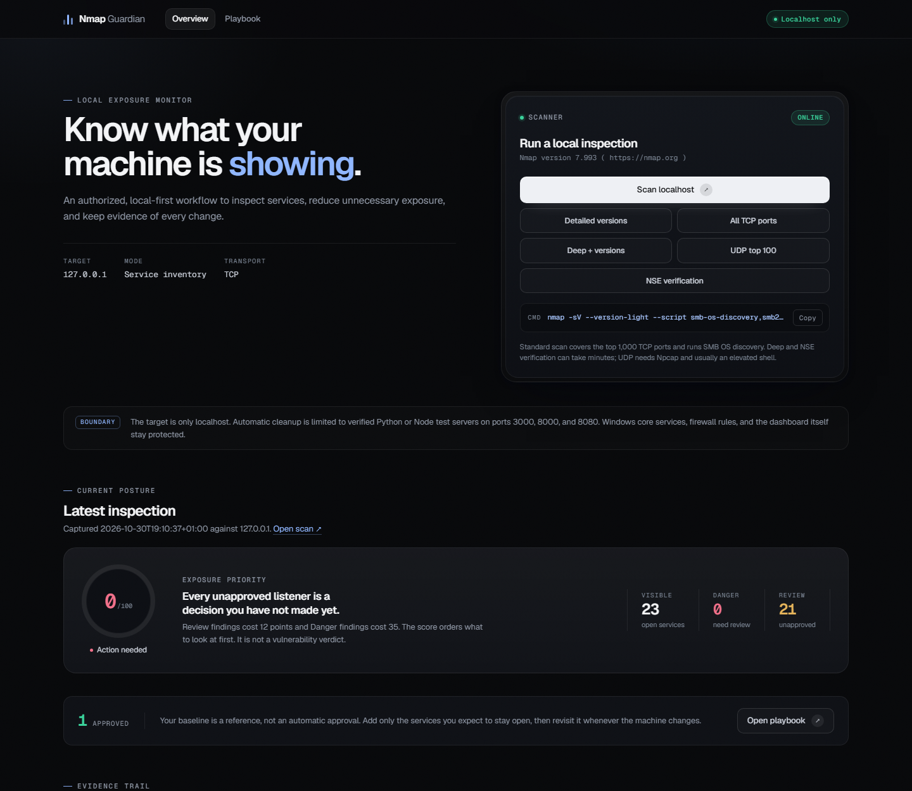
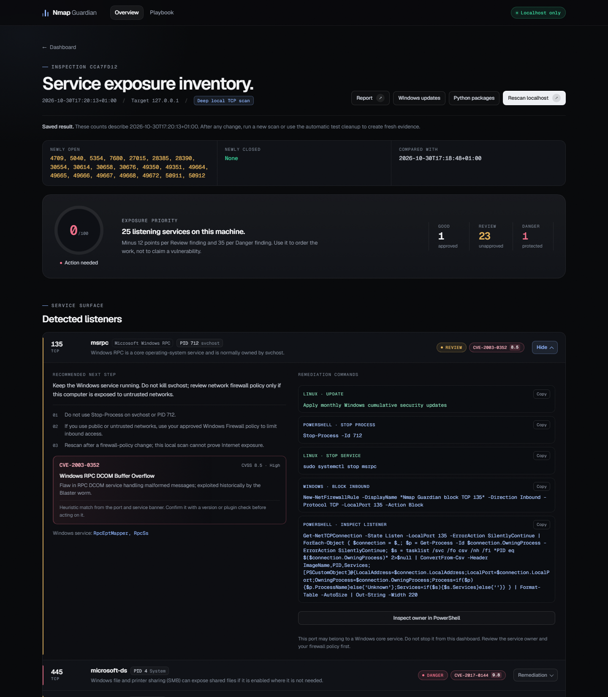
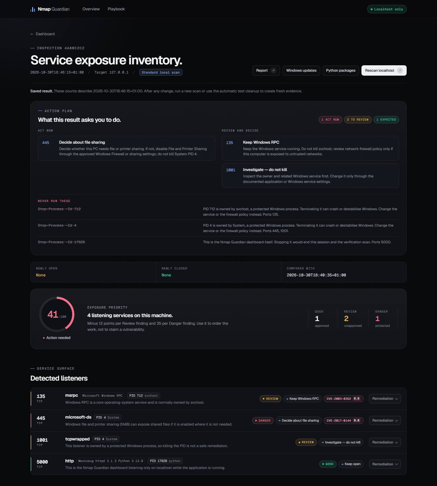
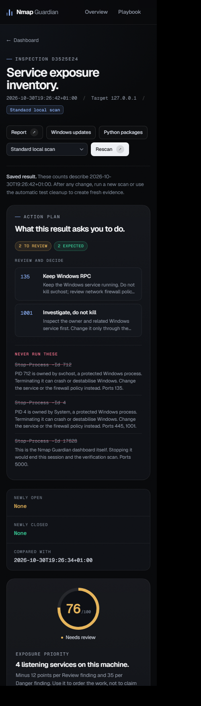

# Nmap Guardian

Nmap Guardian is a local-only Flask dashboard for the **Cartographie et services exposés** coursework project. It uses Nmap to inventory exposed services on `127.0.0.1`, explain unexpected ports, provide safe manual remediation guidance, and verify the result with a subsequent scan.

> The application is intentionally locked to localhost. Do not modify it to scan networks or systems without explicit authorization.

## Features

- Standard scan for common local TCP ports.
- Deep scan for all 65,535 local TCP ports.
- Nmap XML parsing with service and version details when available.
- Good, Review, and Danger findings with explainable rules and a direct per-port decision (keep, close after test, protect, or investigate).
- Approved-port baseline management.
- Exposure score and scan-to-scan change tracking.
- Windows process and PID association for detected local listening ports.
- Copyable PowerShell command plans, a one-click read-only **Inspect in PowerShell** owner/service check, and stop-and-verify for a verified Python/Node test server on ports 3000, 8000, or 8080.
- Read-only Python dependency check that lists outdated packages and presents copyable update commands. It never upgrades packages automatically.
- Read-only Windows Update evidence check (service state, startup type, recent hotfixes). It never downloads or installs updates.
- Printable HTML report.

## Interface









The interface uses a cold graphite instrument-panel language: hairline geometry, a single azure signal accent, semantic status colors, Geist and Geist Mono, and Motion for entry choreography. Every panel has a defined empty, loading, and error state, and the whole layout collapses to a single column at 390 px.

## Safety model

- The target is fixed to `127.0.0.1`.
- The dashboard automatically stops only a verified Python/Node test server on ports 3000, 8000, or 8080, then creates a new verification scan.
- Windows core services, sensitive ports, firewall rules, and the dashboard's own port 5000 never receive automatic actions.
- A finding is an exposure observation, not proof of a vulnerability.
- A package version check indicates that an update exists; it is not a CVE/vulnerability verdict. Review compatibility and update inside the correct virtual environment.

## Run locally

```powershell
pip install -r requirements.txt
python app.py
```

Open http://127.0.0.1:5000.

Nmap must be installed and available in `PATH`.

## Controlled demonstration

```powershell
python -m http.server 8000 --bind 127.0.0.1
```

1. Run a scan and observe port 8000.
2. In the port 8000 command plan, select **Stop test process + verify** (or stop it with `Ctrl+C`).
3. Verify that the fresh scan shows the port under newly closed ports.

## Technology

Python, Flask, Nmap, PowerShell `Get-NetTCPConnection`, JSON, Geist and Geist Mono, and Motion.
